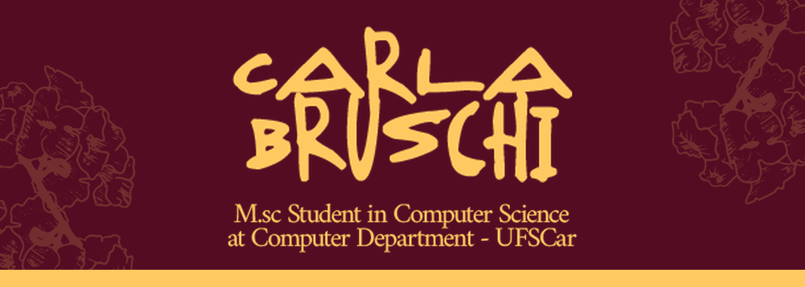
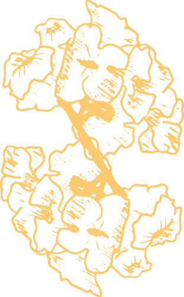
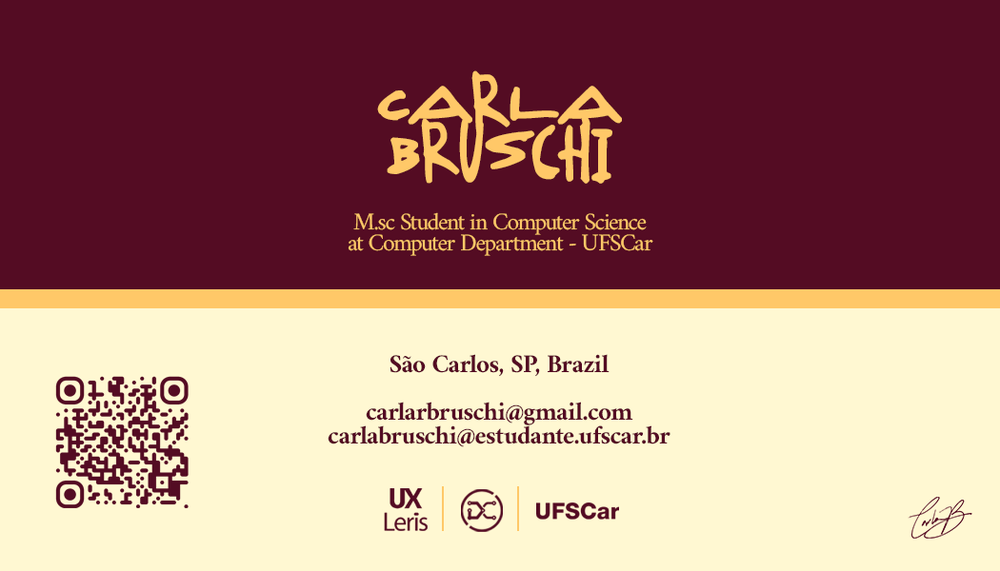
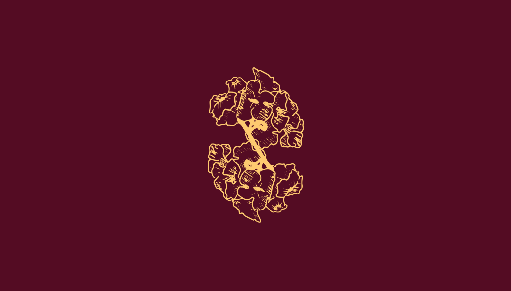
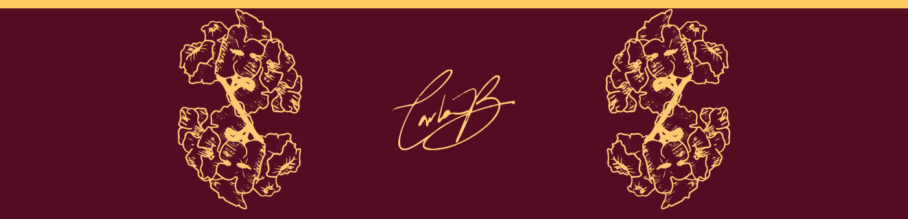

 

<table>
  <tr>
    <td width="150" align="center"></td>
    <td>
      <strong>Adoro um chá de maçã ☕ para acompanhar enquanto trabalho.</strong>  
      Mestranda em Ciência da Computação na <strong>UFSCar</strong> (Computação Centrada no Humano), integrante do grupo de pesquisa <strong>UX Leris</strong>. Pesquiso a integração de <strong>Agentes Inteligentes</strong> para apoiar <strong>UX Research</strong> e <strong>Engenharia de Requisitos</strong> com perspectiva longitudinal.  
      Apaixonada por unir <strong>design centrado no usuário</strong>, <strong>acessibilidade</strong> e <strong>tecnologia</strong> para criar experiências digitais inclusivas e impactantes. ✨
    </td>
  </tr>
</table>

## 🎓 Formação

- **Mestrado em Ciência da Computação** — UFSCar (2026 – atual) · Bolsista CAPES · Orientadora: Profa. Dra. Luciana A. Martinez Zaina
- **Bacharelado em Engenharia de Computação** — UFGD (2020 – 2025)

## 🔬 Áreas de Pesquisa

- **Interação Humano-Computador (IHC)** e **Experiência do Usuário (UX)**
- **Engenharia de Requisitos Ágil** com perspectiva longitudinal da UX
- **Agentes Inteligentes / LLMs** aplicados à UX Research
- **Acessibilidade** e **Design Inclusivo**
- **Jogos Educativos** e protagonismo feminino na tecnologia

## 💻 Habilidades

**Desenvolvimento**

**Design e UX**

## 📚 Publicações e Produções

### Artigos publicados
- **"Bugou?"**: História, tecnologia e diversidade — conhecendo Grace Hopper em um minijogo digital. *WIT 2025*
- **"A Caixinha do Futuro"**: Minijogo sobre a história de Hedy Lamarr para fomentar o protagonismo feminino na tecnologia. *TISE 2025*

### Softwares registrados (INPI)
- 🎮 **Bugou?** — Registro BR512026000276-1
- 🎮 **A Caixinha do Futuro** — Registro BR512026000278-8

### Apresentações e cursos ministrados
- *Temporalidade em UX e o Uso de LLMs/Agentes Inteligentes na UX Research* — EPIHCSP, 2026
- *Introdução ao Design Centrado no Usuário para Desenvolvedores* — oficina na Semana Integrada da Computação, 2025

## 🚀 Projetos em Destaque

### Mestrado — UFSCar
> **Integrando Agentes Inteligentes à Engenharia de Requisitos com Perspectiva Longitudinal da UX**
> - Investigando como agentes inteligentes podem apoiar a integração da dimensão temporal da UX na Engenharia de Requisitos Ágil
> - Mapeamento de práticas, técnicas e ferramentas utilizadas pela indústria em UX Research e RE

### TCC — ElaCoda
> **Série de minigames para homenagear mulheres que moldaram a Computação**
> - Interface e experiência do usuário projetadas com foco em acessibilidade
> - Exposição interativa e nostalgia pixelada! 🕹️

### Estágio — Hospital Universitário UFGD/Ebserh
> **Customização de Plataforma Moodle para Educação a Distância**
> - Personalização de identidade visual e estruturação de cursos
> - Aplicação de princípios de UX e acessibilidade na interface

## 🌟 Atividades Complementares

- **Representante Estudantil** — Sociedade Brasileira de Computação (SBC) | 2023 – atual
- **Coordenadora de Comunicação** — CAECOMP/UFGD | 2023 – 2025
- **Bolsista de Extensão (Design Gráfico)** — Programa Cultura e Arte por Toda Parte | 2023 – 2025
- **Monitora** — Algoritmos e Estruturas de Dados I | 2024

### Cursos e certificações
- Formação UX Design (42h) — Caelum
- Introdução à Libras (60h) — ENAP
- Excel Avançado (30h) — ENAP

## 📊 Estatísticas do GitHub

  
  

  
  

  <i>"Unindo design, tecnologia e propósito para criar experiências que transformam."</i>
   Identidade visual © Carla Bruschi — todos os direitos reservados.

